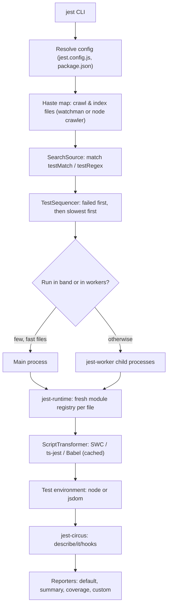
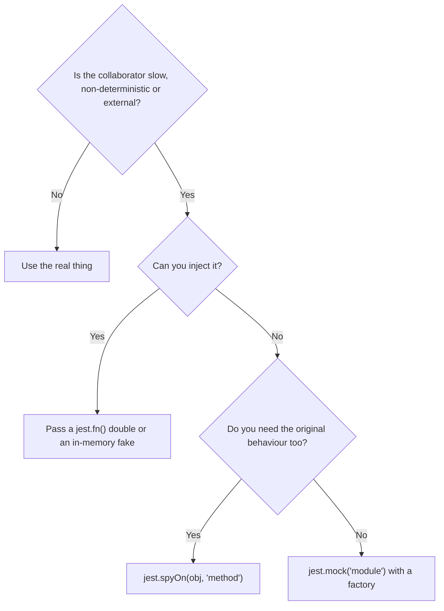
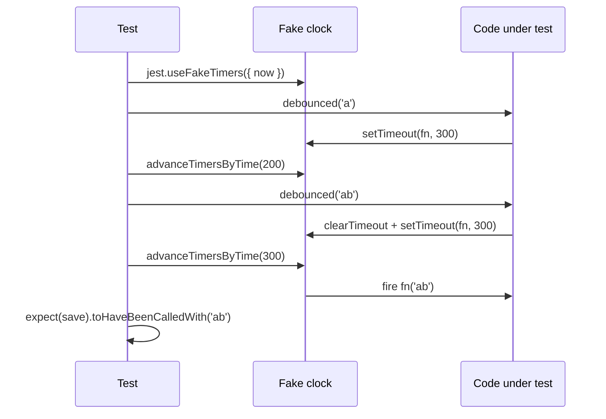
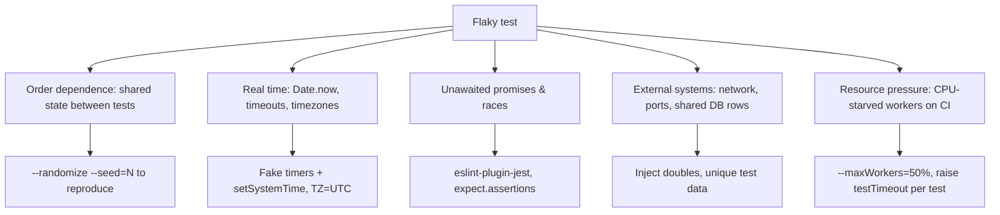

# Learn Jest 🃏

<div align="center">

[](https://opensource.org/licenses/MIT)
[](https://jestjs.io/)
[](https://www.typescriptlang.org/)
[](https://nodejs.org/)
[](https://swc.rs/)
[](https://github.com/TheLearningHubOrg/learn-jest)

**An exhaustive, production-grade masterclass from absolute zero to staff-level JavaScript and TypeScript testing with Jest.**  
Master matchers, mocks and spies, async tests, fake timers, snapshots, coverage gates, and fast CI configuration for TypeScript codebases.

[Getting Started](#1-stage-1-absolute-beginner-foundations--your-first-test-suite) • [Matchers Deep Dive](#2-stage-2-matchers--assertions-deep-dive) • [Mocks & Spies](#3-stage-3-test-doubles-mocks-spies--module-isolation) • [Async & Timers](#4-stage-4-async-testing--fake-timers) • [Snapshots & Architecture](#5-stage-5-snapshots-lifecycle-hooks--test-architecture) • [Coverage & CI](#6-stage-6-coverage-performance--ci-at-scale) • [Staff Handbook](#7-stage-7-staff-quality-engineer-interview-handbook--cheatsheet)

<br/>

<a href="https://www.buymeacoffee.com/manthanank">
  
</a>

</div>

---

## 🗺️ 7-Stage Pedagogical Roadmap


| Stage | Domain Focus | Core Concepts & Production Outcomes |
| :--- | :--- | :--- |
| **Stage 1** | **Foundations & First Test Suite** | Why a test runner exists, Jest's architecture, TypeScript transforms (`@swc/jest`, `ts-jest`, Babel), `describe`/`it`/`expect`, the CLI and watch mode. |
| **Stage 2** | **Matchers & Assertions** | `toBe` vs `toEqual` vs `toStrictEqual`, numbers and floats, exceptions, asymmetric matchers, `test.each` tables, custom matchers with `expect.extend`. |
| **Stage 3** | **Test Doubles & Module Isolation** | `jest.fn()`, `mock.calls`, `jest.spyOn`, `jest.mock` hoisting, `jest.mocked`, `requireActual`, manual `__mocks__`, ESM `unstable_mockModule`, clear vs reset vs restore. |
| **Stage 4** | **Async Testing & Fake Timers** | Promises, `resolves`/`rejects`, `expect.assertions`, mocking `fetch`, modern fake timers, `advanceTimersByTimeAsync`, `setSystemTime`, timer and promise interplay. |
| **Stage 5** | **Snapshots, Hooks & Architecture** | Hook ordering and scope, file vs inline snapshots, property matchers, serializers, test data builders, `node` vs `jsdom` environments. |
| **Stage 6** | **Coverage, Performance & CI** | `v8` vs `babel` coverage, thresholds, `projects`, worker tuning, `--shard`, cache, flaky test hunting, `--detectOpenHandles`, Docker and GitHub Actions pipelines. |
| **Stage 7** | **Staff Quality Engineer Handbook** | 40 staff-level scenario Q&As, failure modes, decision frameworks, and an enterprise CLI and API cheatsheet. |

---

## 📋 Table of Contents
- [1. Stage 1: Absolute Beginner Foundations & Your First Test Suite](#1-stage-1-absolute-beginner-foundations--your-first-test-suite)
  - [1.1 Why Automated Tests & Why Jest](#11-why-automated-tests--why-jest)
  - [1.2 How Jest Works Under the Hood](#12-how-jest-works-under-the-hood)
  - [1.3 Installing Jest for a TypeScript Project](#13-installing-jest-for-a-typescript-project)
  - [1.4 Anatomy of a Test File](#14-anatomy-of-a-test-file)
  - [1.5 Driving the Jest CLI](#15-driving-the-jest-cli)
- [2. Stage 2: Matchers & Assertions Deep Dive](#2-stage-2-matchers--assertions-deep-dive)
  - [2.1 Equality: toBe, toEqual & toStrictEqual](#21-equality-tobe-toequal--tostrictequal)
  - [2.2 Numbers, Strings, Collections & Truthiness](#22-numbers-strings-collections--truthiness)
  - [2.3 Asserting on Errors](#23-asserting-on-errors)
  - [2.4 Asymmetric Matchers](#24-asymmetric-matchers)
  - [2.5 Table-Driven Tests with test.each](#25-table-driven-tests-with-testeach)
  - [2.6 Custom Matchers with expect.extend](#26-custom-matchers-with-expectextend)
- [3. Stage 3: Test Doubles, Mocks, Spies & Module Isolation](#3-stage-3-test-doubles-mocks-spies--module-isolation)
  - [3.1 The Test Double Vocabulary](#31-the-test-double-vocabulary)
  - [3.2 jest.fn() & the Mock API](#32-jestfn--the-mock-api)
  - [3.3 Dependency Injection First](#33-dependency-injection-first)
  - [3.4 Module Mocking with jest.mock](#34-module-mocking-with-jestmock)
  - [3.5 Spies with jest.spyOn](#35-spies-with-jestspyon)
  - [3.6 Clear vs Reset vs Restore](#36-clear-vs-reset-vs-restore)
  - [3.7 Manual Mocks & Native ESM Mocking](#37-manual-mocks--native-esm-mocking)
- [4. Stage 4: Async Testing & Fake Timers](#4-stage-4-async-testing--fake-timers)
  - [4.1 Promises, async/await & resolves/rejects](#41-promises-asyncawait--resolvesrejects)
  - [4.2 Guarding Against Silent Passes](#42-guarding-against-silent-passes)
  - [4.3 Mocking fetch & HTTP Boundaries](#43-mocking-fetch--http-boundaries)
  - [4.4 Modern Fake Timers](#44-modern-fake-timers)
  - [4.5 Timers Meet Promises](#45-timers-meet-promises)
- [5. Stage 5: Snapshots, Lifecycle Hooks & Test Architecture](#5-stage-5-snapshots-lifecycle-hooks--test-architecture)
  - [5.1 Lifecycle Hooks & Execution Order](#51-lifecycle-hooks--execution-order)
  - [5.2 Snapshot Testing Done Right](#52-snapshot-testing-done-right)
  - [5.3 Test Data Builders & Fixtures](#53-test-data-builders--fixtures)
  - [5.4 Test Environments: node vs jsdom](#54-test-environments-node-vs-jsdom)
- [6. Stage 6: Coverage, Performance & CI at Scale](#6-stage-6-coverage-performance--ci-at-scale)
  - [6.1 Coverage Providers & Thresholds](#61-coverage-providers--thresholds)
  - [6.2 Production jest.config Blueprint](#62-production-jestconfig-blueprint)
  - [6.3 Making Large Suites Fast](#63-making-large-suites-fast)
  - [6.4 Hunting Flaky Tests & Open Handles](#64-hunting-flaky-tests--open-handles)
  - [6.5 CI Pipeline: GitHub Actions & Docker](#65-ci-pipeline-github-actions--docker)
- [7. Stage 7: Staff Quality Engineer Interview Handbook & Cheatsheet](#7-stage-7-staff-quality-engineer-interview-handbook--cheatsheet)
  - [7.1 Enterprise Production Cheatsheet](#71-enterprise-production-cheatsheet)
  - [7.2 Staff & Principal Architect Interview Q&A (40 Scenarios)](#72-staff--principal-architect-interview-qa-40-scenarios)
- [🤝 Contributing](#-contributing)
- [📄 License](#-license)

---

## 1. Stage 1: Absolute Beginner Foundations & Your First Test Suite

### 1.1 Why Automated Tests & Why Jest

A test is a small program that runs your real code with known inputs and checks the outputs. Once you have a few hundred of them, they become a safety net: you can refactor, upgrade dependencies, or hand the codebase to a new teammate and find out within seconds whether behaviour changed.

A **test runner** is the machinery around those checks. It finds test files, loads them, isolates them from each other, runs them (often in parallel), and reports what failed and why. Jest bundles everything a JavaScript team usually needs into one package:

1. **Runner & scheduler:** parallel workers, smart ordering, watch mode that only reruns affected files.
2. **Assertion library:** `expect` with a large set of matchers and readable diffs.
3. **Test doubles:** `jest.fn()`, `jest.spyOn()`, and module-level mocking through its own module registry.
4. **Fake timers:** control `setTimeout`, `setInterval` and `Date` without waiting in real time.
5. **Snapshots:** store serialized output next to the test and fail when it drifts.
6. **Coverage:** built-in Istanbul or V8 coverage with enforceable thresholds.

The testing pyramid still holds: many fast unit tests at the bottom, fewer integration tests in the middle, and a thin layer of end-to-end tests at the top. Jest owns the bottom two layers. Browser-level end-to-end flows belong to a tool such as Playwright.

```
           /\
          /  \        E2E (Playwright)       slow, few, real browser
         /----\
        /      \      Integration (Jest)     real modules, fake network/db edges
       /--------\
      /          \    Unit (Jest)            pure logic, injected doubles, milliseconds
     /____________\
```

### 1.2 How Jest Works Under the Hood

Knowing the pipeline explains most of Jest's behaviour, including why `jest.mock` calls are hoisted and why every test file gets fresh module state.



Key consequences:

1. **Isolation per file:** each test file runs inside its own VM context with its own module registry. A module-level variable mutated in `a.test.ts` is never visible in `b.test.ts`.
2. **No isolation inside a file:** tests in the same file share module state, so hooks and `clearMocks` matter.
3. **Transforms are cached** on disk keyed by file content and config. The first run is slower than every later run.
4. **Workers are processes**, so a module-level singleton (a DB pool, a cache) exists once per worker, not once per run.

### 1.3 Installing Jest for a TypeScript Project

Jest executes JavaScript, so TypeScript must be transformed first. There are three mainstream options:

| Transformer | Type checks during tests? | Speed | When to choose |
| :--- | :--- | :--- | :--- |
| **`@swc/jest`** | No | Very fast (Rust) | Default choice. Run `tsc --noEmit` separately in CI. |
| **`ts-jest`** | Yes (unless `isolatedModules`) | Slowest | You want type errors to fail the test run itself. |
| **`babel-jest`** + `@babel/preset-typescript` | No | Fast | You already have a Babel pipeline (e.g. React Native). |

```bash
# 1. Create the project
mkdir learn-jest && cd learn-jest
npm init -y

# 2. Install Jest, typed globals and the SWC transformer
npm install --save-dev jest @jest/globals @swc/core @swc/jest typescript @types/node

# 3. (Alternative) type-checking transformer instead of SWC
npm install --save-dev ts-jest

# 4. Run the suite
npx jest
```

A minimal configuration for a TypeScript project that ships as native ESM (`"type": "module"`) but lets SWC compile tests to CommonJS, which keeps `jest.mock` hoisting fully supported:

```javascript
// jest.config.js
/** @type {import('jest').Config} */
export default {
  testEnvironment: 'node',
  roots: ['<rootDir>/tests'],
  transform: {
    '^.+\\.ts$': [
      '@swc/jest',
      {
        jsc: { parser: { syntax: 'typescript' }, target: 'es2022' },
        module: { type: 'commonjs' },
      },
    ],
  },
  // NodeNext-style imports end in ".js"; point them back at the .ts source.
  moduleNameMapper: { '^(\\.{1,2}/.*)\\.js$': '$1' },
  clearMocks: true,
  restoreMocks: true,
};
```

If you prefer the config itself in TypeScript (`jest.config.ts`), Jest needs a loader such as `ts-node` installed to read it. A `.js` config with a JSDoc type annotation gives the same editor autocompletion with no extra dependency.

### 1.4 Anatomy of a Test File

Jest finds files matching `**/__tests__/**/*` or `*.test.*` / `*.spec.*` by default. Inside, three building blocks do almost everything:

1. **`describe(name, fn)`** groups related tests and scopes hooks.
2. **`it(name, fn)`** (alias `test`) defines one test case. It fails if it throws or returns a rejected promise.
3. **`expect(value)`** wraps a value and exposes matchers.

Structure each test as **Arrange, Act, Assert**:

```typescript
// tests/pricing.test.ts
import { describe, expect, it } from '@jest/globals';
import { subtotal, totalFor } from '../src/pricing.js';

describe('pricing', () => {
  const cart = [
    { sku: 'BOOK-1', unitPrice: 2999, quantity: 2 },
    { sku: 'PEN-9', unitPrice: 199, quantity: 3 },
  ];

  it('adds line items in cents', () => {
    // Arrange is the cart above. Act:
    const result = subtotal(cart);
    // Assert:
    expect(result).toBe(6595);
  });

  it('applies a 10% discount for the pro plan', () => {
    expect(totalFor({ plan: 'pro' }, cart)).toBe(5936);
  });

  it.todo('applies regional tax');
});
```

Importing `describe`, `it`, `expect` and `jest` from `@jest/globals` makes them typed without polluting the global type space. The alternative is `@types/jest`, which declares them as globals; pick one per project and stay consistent.

Modifiers you will use daily:

| Modifier | Effect |
| :--- | :--- |
| `it.only` / `describe.only` | Run only these within the file. Never commit it; lint with `jest/no-focused-tests`. |
| `it.skip` / `describe.skip` | Skip, reported as skipped. |
| `it.todo('name')` | Placeholder that shows up in the summary. |
| `it.failing` | Passes only if the body fails. Useful to pin a known bug. |
| `it.concurrent` | Runs async tests in the same file concurrently. Use with care; hooks do not run per concurrent test the way you might expect. |

### 1.5 Driving the Jest CLI

```bash
# 1. Everyday commands
npx jest                          # run everything once
npx jest --watch                  # rerun tests related to changed files (needs git)
npx jest --watchAll               # rerun everything on any change
npx jest pricing                  # only test files whose path matches "pricing"
npx jest -t "discount"            # only tests whose name matches "discount"

# 2. Narrowing scope for big repos
npx jest --onlyChanged            # tests related to uncommitted changes
npx jest --changedSince=origin/main
npx jest --findRelatedTests src/pricing.ts src/retry.ts

# 3. Diagnostics
npx jest --listTests              # print matched test files, run nothing
npx jest --showConfig             # print fully resolved config
npx jest --runInBand              # single process; best for debugging
npx jest --detectOpenHandles      # report handles keeping Node alive
npx jest --verbose                # one line per test

# 4. Debug with Chrome DevTools or VS Code
node --inspect-brk node_modules/jest/bin/jest.js --runInBand tests/app.test.ts
```

Jest 30 renamed the path filter flag to `--testPathPatterns` (plural). Old scripts using `--testPathPattern` need updating during the upgrade.

---

## 2. Stage 2: Matchers & Assertions Deep Dive

### 2.1 Equality: toBe, toEqual & toStrictEqual

Choosing the wrong equality matcher is the most common source of tests that pass when they should not.

| Matcher | Algorithm | `{a: 1, b: undefined}` equals `{a: 1}`? | Class instance equals plain object? |
| :--- | :--- | :--- | :--- |
| `toBe` | `Object.is` (identity for objects) | No (different references) | No |
| `toEqual` | Recursive structural equality | **Yes** | **Yes** |
| `toStrictEqual` | Structural + types + `undefined` keys + sparse arrays | No | No |

```typescript
import { expect, it } from '@jest/globals';

class Money {
  constructor(public amount: number) {}
}

it('shows how the three equality matchers differ', () => {
  expect(2 + 2).toBe(4);
  expect(NaN).toBe(NaN);              // Object.is treats NaN as equal to itself
  expect(0).not.toBe(-0);             // ...and +0 and -0 as different

  expect({ a: 1, b: undefined }).toEqual({ a: 1 });
  expect({ a: 1, b: undefined }).not.toStrictEqual({ a: 1 });

  expect(new Money(5)).toEqual({ amount: 5 });
  expect(new Money(5)).not.toStrictEqual({ amount: 5 });

  expect([, 1]).toEqual([undefined, 1]);
  expect([, 1]).not.toStrictEqual([undefined, 1]);
});
```

Rule of thumb: `toBe` for primitives and identity checks, `toStrictEqual` for domain objects and API responses, `toEqual` when you deliberately want to ignore class identity or optional `undefined` fields.

### 2.2 Numbers, Strings, Collections & Truthiness

```typescript
import { expect, it } from '@jest/globals';

it('covers the everyday matchers', () => {
  // 1. Numbers: never compare floats with toBe
  expect(0.1 + 0.2).toBeCloseTo(0.3);          // default precision: 2 decimal places
  expect(0.1 + 0.2).toBeCloseTo(0.3, 10);
  expect(42).toBeGreaterThan(41);
  expect(42).toBeLessThanOrEqual(42);

  // 2. Strings
  expect('Order #A-1029 shipped').toMatch(/#[A-Z]-\d{4}/);
  expect('hello world').toContain('world');
  expect('abc').toHaveLength(3);

  // 3. Arrays and iterables
  expect(['ts', 'jest', 'swc']).toContain('jest');               // uses ===
  expect([{ id: 1 }, { id: 2 }]).toContainEqual({ id: 2 });      // uses structural equality
  expect(new Set([1, 2, 3])).toContain(2);

  // 4. Objects
  const user = { id: 'u1', profile: { city: 'Pune', zip: '411001' } };
  expect(user).toHaveProperty('profile.city', 'Pune');
  expect(user).toHaveProperty(['profile', 'zip']);
  expect(user).toMatchObject({ profile: { city: 'Pune' } });     // subset match

  // 5. Truthiness: prefer the most specific matcher available
  expect(null).toBeNull();
  expect(undefined).toBeUndefined();
  expect('value').toBeDefined();
  expect(0).toBeFalsy();
  expect([]).toBeTruthy();
  expect(new Date()).toBeInstanceOf(Date);
});
```

Specific matchers produce specific failure messages. `expect(list.length === 3).toBe(true)` fails with "expected true, received false", while `expect(list).toHaveLength(3)` prints the actual length and contents.

### 2.3 Asserting on Errors

`toThrow` needs a **function** to call, otherwise the error is thrown before `expect` ever sees it.

```typescript
import { expect, it } from '@jest/globals';
import { subtotal } from '../src/pricing.js';
import { NotFoundError } from '../src/types.js';

it('asserts on synchronous errors', () => {
  const bad = [{ sku: 'X', unitPrice: 100, quantity: 1.5 }];

  expect(() => subtotal(bad)).toThrow();                      // any error
  expect(() => subtotal(bad)).toThrow(RangeError);            // by class
  expect(() => subtotal(bad)).toThrow('Invalid quantity');    // message substring
  expect(() => subtotal(bad)).toThrow(/for X: 1\.5$/);        // message regex

  // Inspect custom fields by catching explicitly
  const error = new NotFoundError('User', 'u9');
  expect(error).toMatchObject({ name: 'NotFoundError', message: 'User u9 not found' });
});
```

Jest 30 removed the long-deprecated alias matchers. `toThrowError` becomes `toThrow`, `toBeCalledWith` becomes `toHaveBeenCalledWith`, `lastCalledWith` becomes `toHaveBeenLastCalledWith`, and `toReturnWith` becomes `toHaveReturnedWith`. A codemod or a find-and-replace pass handles this during an upgrade.

### 2.4 Asymmetric Matchers

Asymmetric matchers sit **inside** an expected value and match a category of values instead of one exact value. They are what make assertions on generated IDs, timestamps and large payloads practical.

```typescript
import { expect, it } from '@jest/globals';

it('matches the parts that matter and tolerates the rest', () => {
  const event = {
    id: crypto.randomUUID(),
    type: 'order.created',
    createdAt: new Date(),
    payload: { orderId: 'A-1029', items: ['BOOK-1', 'PEN-9'], total: 5936 },
    meta: { region: 'ap-south-1', trace: 'abc123' },
  };

  expect(event).toEqual({
    id: expect.stringMatching(/^[0-9a-f-]{36}$/),
    type: 'order.created',
    createdAt: expect.any(Date),
    payload: expect.objectContaining({
      orderId: 'A-1029',
      items: expect.arrayContaining(['PEN-9']),
    }),
    meta: expect.anything(),       // anything except null or undefined
  });

  expect(event.payload.items).toEqual(expect.not.arrayContaining(['LAPTOP']));
  expect({ ratio: 0.30000000000000004 }).toEqual({ ratio: expect.closeTo(0.3, 5) });
});
```

### 2.5 Table-Driven Tests with test.each

Tables keep many similar cases readable and make the missing case obvious in review.

```typescript
import { describe, expect, it } from '@jest/globals';
import { totalFor } from '../src/pricing.js';

const cart = [{ sku: 'BOOK-1', unitPrice: 10_000, quantity: 1 }];

describe('plan discounts', () => {
  // 1. Array rows: printf-style placeholders in the title
  it.each([
    ['free', 10_000],
    ['pro', 9_000],
    ['enterprise', 7_500],
  ] as const)('%s plan pays %i cents', (plan, expected) => {
    expect(totalFor({ plan }, cart)).toBe(expected);
  });

  // 2. Object rows: $name interpolation, the most readable form
  it.each([
    { plan: 'free' as const, expected: 10_000 },
    { plan: 'enterprise' as const, expected: 7_500 },
  ])('$plan plan pays $expected cents', ({ plan, expected }) => {
    expect(totalFor({ plan }, cart)).toBe(expected);
  });
});
```

There is also a tagged template literal form (`` it.each`a | b | expected` ``). It reads nicely but loses type inference in TypeScript, so the array and object forms are preferred in typed codebases.

### 2.6 Custom Matchers with expect.extend

When the same three-line assertion appears in fifty tests, promote it to a matcher. You get one clear failure message and a domain vocabulary.

```typescript
// tests/matchers.ts
import { expect } from '@jest/globals';
import type { MatcherFunction } from 'expect';

const toBeValidSku: MatcherFunction<[]> = function (received) {
  const pass = typeof received === 'string' && /^[A-Z]{2,6}-\d{1,4}$/.test(received);
  return {
    pass,
    message: () =>
      `expected ${this.utils.printReceived(received)} ${pass ? 'not ' : ''}to be a SKU like "BOOK-1"`,
  };
};

const toBeWithinRange: MatcherFunction<[floor: number, ceiling: number]> = function (
  received,
  floor,
  ceiling,
) {
  if (typeof received !== 'number') throw new TypeError('toBeWithinRange expects a number');
  const pass = received >= floor && received <= ceiling;
  return {
    pass,
    message: () =>
      `expected ${this.utils.printReceived(received)} ${pass ? 'not ' : ''}to be within ` +
      `${this.utils.printExpected(`${floor} - ${ceiling}`)}`,
  };
};

expect.extend({ toBeValidSku, toBeWithinRange });

// Teach TypeScript about the new matchers (for @jest/globals users)
declare module 'expect' {
  interface AsymmetricMatchers {
    toBeValidSku(): void;
    toBeWithinRange(floor: number, ceiling: number): void;
  }
  interface Matchers<R> {
    toBeValidSku(): R;
    toBeWithinRange(floor: number, ceiling: number): R;
  }
}
```

Register the file once with `setupFilesAfterEnv: ['<rootDir>/tests/matchers.ts']`, then use `expect('BOOK-1').toBeValidSku()` or `expect.toBeWithinRange(1, 10)` inside larger expected objects. For mature matcher collections, `jest-extended` adds around a hundred more.

---

## 3. Stage 3: Test Doubles, Mocks, Spies & Module Isolation

### 3.1 The Test Double Vocabulary

"Mock" is used loosely, but the distinctions guide design:

1. **Dummy:** passed only to satisfy a signature, never used.
2. **Stub:** returns canned answers (`mockResolvedValue(user)`).
3. **Spy:** records calls so you can assert on them afterwards (`toHaveBeenCalledWith`).
4. **Mock:** a stub plus spy with expectations about how it is used. In Jest, `jest.fn()` is all three at once.
5. **Fake:** a working but simplified implementation, such as an in-memory repository.



### 3.2 jest.fn() & the Mock API

```typescript
import { expect, it, jest } from '@jest/globals';

it('records every call, return value and this binding', () => {
  // 1. A typed mock: the generic is the function signature
  const tax = jest.fn((amount: number, rate: number) => Math.round(amount * rate));

  tax(1000, 0.18);
  tax(2500, 0.05);

  // 2. Inspect raw call data
  expect(tax.mock.calls).toEqual([
    [1000, 0.18],
    [2500, 0.05],
  ]);
  expect(tax.mock.results[0]).toEqual({ type: 'return', value: 180 });
  expect(tax.mock.lastCall).toEqual([2500, 0.05]);

  // 3. Prefer the call matchers for readable failures
  expect(tax).toHaveBeenCalledTimes(2);
  expect(tax).toHaveBeenNthCalledWith(1, 1000, 0.18);
  expect(tax).toHaveBeenLastCalledWith(2500, expect.any(Number));
  expect(tax).toHaveReturnedWith(125);
});

it('programs behaviour per call', async () => {
  const fetchRate = jest
    .fn<(currency: string) => Promise<number>>()
    .mockResolvedValueOnce(83.1)                       // first call
    .mockRejectedValueOnce(new Error('rate limited'))  // second call
    .mockResolvedValue(83.4);                          // every later call

  await expect(fetchRate('INR')).resolves.toBe(83.1);
  await expect(fetchRate('INR')).rejects.toThrow('rate limited');
  await expect(fetchRate('INR')).resolves.toBe(83.4);
  await expect(fetchRate('INR')).resolves.toBe(83.4);

  // mockImplementation gives full control when canned values are not enough
  const byCurrency = jest.fn((c: string) => (c === 'EUR' ? 0.92 : 1));
  byCurrency.mockImplementationOnce(() => 0);
  expect([byCurrency('EUR'), byCurrency('EUR')]).toEqual([0, 0.92]);
});
```

`mockName('rateClient')` makes failure messages print a friendly name instead of `jest.fn()`, which pays off in big suites.

### 3.3 Dependency Injection First

The most maintainable mocks are the ones you do not need module mocking for. If a class receives its collaborators through the constructor, tests pass doubles directly. This is how the companion project's `UserService` is built:

```typescript
// src/userService.ts (abridged)
export class UserService {
  constructor(
    private readonly http: HttpClient,
    private readonly notifier: Notifier,
    private readonly baseUrl = 'https://api.example.com',
  ) {}

  async getUser(id: string): Promise<User> {
    const user = await this.http.get<User | null>(`${this.baseUrl}/users/${encodeURIComponent(id)}`);
    if (!user) throw new NotFoundError('User', id);
    return user;
  }
}
```

```typescript
// tests/app.test.ts (abridged)
function makeDoubles() {
  // HttpClient.get is generic, so the mock is pinned to this suite's payload type
  const get = jest.fn<(url: string) => Promise<User | null>>();
  const send = jest.fn<Notifier['send']>().mockResolvedValue(undefined);
  const service = new UserService({ get } as unknown as HttpClient, { send }, 'https://api.test');
  return { get, send, service };
}

it('throws NotFoundError when the API returns null', async () => {
  const { get, service } = makeDoubles();
  get.mockResolvedValue(null);

  await expect(service.getUser('ghost')).rejects.toThrow(NotFoundError);
  expect(get).toHaveBeenCalledWith('https://api.test/users/ghost');
});
```

Benefits: no hoisting rules, no module registry tricks, full type checking, and it works identically under CommonJS and native ESM.

### 3.4 Module Mocking with jest.mock

When code imports a dependency directly, `jest.mock` swaps the module in Jest's registry for the whole test file.

```typescript
// src/checkout.ts
import { chargeCard } from './payments.js';
import { sendReceipt } from './mailer.js';

export async function checkout(orderId: string, cents: number, email: string) {
  const charge = await chargeCard(orderId, cents);
  await sendReceipt(email, charge.id);
  return charge.id;
}
```

```typescript
// tests/checkout.test.ts
import { beforeEach, expect, it, jest } from '@jest/globals';
import { checkout } from '../src/checkout.js';
import { chargeCard } from '../src/payments.js';
import { sendReceipt } from '../src/mailer.js';

// 1. Automock: every export becomes a jest.fn() returning undefined
jest.mock('../src/mailer.js');

// 2. Factory mock: you decide exactly what the module exports
jest.mock('../src/payments.js', () => ({
  chargeCard: jest.fn(async () => ({ id: 'ch_test_1', status: 'succeeded' })),
}));

// 3. jest.mocked() narrows the imported binding to its mocked type
const mockedCharge = jest.mocked(chargeCard);
const mockedReceipt = jest.mocked(sendReceipt);

beforeEach(() => {
  mockedReceipt.mockResolvedValue(undefined);
});

it('charges the card then emails the receipt', async () => {
  await expect(checkout('A-1029', 5936, 'ada@example.com')).resolves.toBe('ch_test_1');
  expect(mockedCharge).toHaveBeenCalledWith('A-1029', 5936);
  expect(mockedReceipt).toHaveBeenCalledWith('ada@example.com', 'ch_test_1');
});

it('does not email when the charge fails', async () => {
  mockedCharge.mockRejectedValueOnce(new Error('card_declined'));
  await expect(checkout('A-1030', 100, 'ada@example.com')).rejects.toThrow('card_declined');
  expect(mockedReceipt).not.toHaveBeenCalled();
});
```

How it works: the Babel or SWC Jest plugin **hoists** `jest.mock` calls above the `import` statements, so the registry is primed before `checkout.ts` loads its dependencies. Because the factory runs before the file's own variables exist, it may only reference imports from `@jest/globals`, globals, and variables whose names start with `mock`.

Partial mocks keep most of a module real:

```typescript
jest.mock('../src/pricing.js', () => {
  const actual = jest.requireActual<typeof import('../src/pricing.js')>('../src/pricing.js');
  return {
    ...actual,
    formatCents: jest.fn(() => '<price>'), // only this export is replaced
  };
});
```

### 3.5 Spies with jest.spyOn

`jest.spyOn(object, 'method')` wraps an existing method. By default it calls through to the original, so you observe without changing behaviour; chain `mockImplementation` to override.

```typescript
import { afterEach, expect, it, jest } from '@jest/globals';

afterEach(() => {
  jest.restoreAllMocks(); // put the original methods back
});

it('observes a console warning without printing it', () => {
  const warn = jest.spyOn(console, 'warn').mockImplementation(() => {});

  console.warn('deprecated option: legacyMode');

  expect(warn).toHaveBeenCalledWith(expect.stringContaining('legacyMode'));
});

it('pins Math.random and crypto.randomUUID', () => {
  jest.spyOn(Math, 'random').mockReturnValue(0.42);
  jest.spyOn(crypto, 'randomUUID').mockReturnValue('00000000-0000-4000-8000-000000000000');

  expect(Math.random()).toBe(0.42);
  expect(crypto.randomUUID()).toMatch(/^0{8}-/);
});

it('spies on getters and setters', () => {
  const config = {
    get region() {
      return 'us-east-1';
    },
  };
  jest.spyOn(config, 'region', 'get').mockReturnValue('ap-south-1');
  expect(config.region).toBe('ap-south-1');
});
```

A spy can only replace a property that is writable or configurable. ESM namespace objects are frozen and SWC/TypeScript CommonJS output often defines exports as getters, so `jest.spyOn(moduleNamespace, 'fn')` frequently throws. Use dependency injection or `jest.mock` for module exports.

### 3.6 Clear vs Reset vs Restore

| API / config | Clears `mock.calls` & `mock.results` | Removes programmed implementations | Restores original (spies) |
| :--- | :---: | :---: | :---: |
| `mockFn.mockClear()` / `clearMocks: true` | ✅ | ❌ | ❌ |
| `mockFn.mockReset()` / `resetMocks: true` | ✅ | ✅ | ❌ |
| `mockFn.mockRestore()` / `restoreMocks: true` | ✅ | ✅ | ✅ (spies only) |

Recommended defaults in `jest.config.js`: `clearMocks: true` so call counts never leak between tests, and `restoreMocks: true` so spies on globals such as `console` or `Date` never outlive their test. Turn on `resetMocks` only if every test programs its own mock behaviour, because it wipes implementations set in factories and `beforeAll` hooks.

### 3.7 Manual Mocks & Native ESM Mocking

**Manual mocks** live in a `__mocks__` directory next to the module (or at the root for node_modules packages) and are used automatically by `jest.mock('name')` without a factory:

```
src/
├── mailer.ts
└── __mocks__/
    └── mailer.ts      # used by jest.mock('../src/mailer.js')
__mocks__/
└── @aws-sdk/
    └── client-s3.ts   # root-level: replaces the package for every test that calls jest.mock
```

```typescript
// src/__mocks__/mailer.ts
import { jest } from '@jest/globals';

export const outbox: Array<{ to: string; chargeId: string }> = [];

export const sendReceipt = jest.fn(async (to: string, chargeId: string) => {
  outbox.push({ to, chargeId });
});
```

**Native ESM.** When tests run as real ES modules (`node --experimental-vm-modules`, with `extensionsToTreatAsEsm: ['.ts']`), static imports are linked before any code runs, so hoisting cannot work. Use `jest.unstable_mockModule` and import the code under test dynamically **after** registering the mock:

```typescript
// tests/checkout.esm.test.ts (run with NODE_OPTIONS=--experimental-vm-modules)
import { expect, it, jest } from '@jest/globals';

jest.unstable_mockModule('../src/payments.js', () => ({
  chargeCard: jest.fn(async () => ({ id: 'ch_esm', status: 'succeeded' })),
}));
jest.unstable_mockModule('../src/mailer.js', () => ({
  sendReceipt: jest.fn(async () => undefined),
}));

// Dynamic imports resolve after the mocks are registered
const { checkout } = await import('../src/checkout.js');
const { sendReceipt } = await import('../src/mailer.js');

it('works with native ES modules', async () => {
  await expect(checkout('A-1', 100, 'ada@example.com')).resolves.toBe('ch_esm');
  expect(sendReceipt).toHaveBeenCalledWith('ada@example.com', 'ch_esm');
});
```

ESM support in Jest is still flagged experimental. Compiling tests to CommonJS (as the companion project does) is the lower-risk path for most teams in late 2026.

---

## 4. Stage 4: Async Testing & Fake Timers

### 4.1 Promises, async/await & resolves/rejects

A test is async if its function returns a promise. Jest waits for that promise and fails the test on rejection.

```typescript
import { expect, it } from '@jest/globals';

const loadConfig = async (env: string) => {
  if (env === 'prod') return { replicas: 6, debug: false };
  throw new Error(`unknown env: ${env}`);
};

it('style 1: async/await with try-free assertions', async () => {
  const config = await loadConfig('prod');
  expect(config.replicas).toBe(6);
});

it('style 2: resolves and rejects (remember to await or return them)', async () => {
  await expect(loadConfig('prod')).resolves.toMatchObject({ debug: false });
  await expect(loadConfig('qa')).rejects.toThrow('unknown env: qa');
});

it('style 3: callback APIs via a promise wrapper instead of done()', async () => {
  const legacyRead = (cb: (err: Error | null, data?: string) => void) =>
    setImmediate(() => cb(null, 'payload'));

  const data = await new Promise<string>((resolve, reject) =>
    legacyRead((err, value) => (err ? reject(err) : resolve(value!))),
  );
  expect(data).toBe('payload');
});
```

The `done` callback still exists for callback-style tests, but mixing `done` with an `async` function is an error in Jest, and a forgotten `done()` turns into a five-second timeout. Wrapping callbacks in a promise is clearer.

### 4.2 Guarding Against Silent Passes

The classic async bug: the assertion lives in a `.then` or `catch` branch that never runs, and the test passes with zero assertions.

```typescript
import { expect, it } from '@jest/globals';

const mightReject = async (fail: boolean) => {
  if (fail) throw new Error('boom');
  return 'ok';
};

// BAD: if mightReject resolves, the catch never runs and the test still passes
it('silently passes (do not copy)', async () => {
  try {
    await mightReject(false);
  } catch (e) {
    expect(e).toBeInstanceOf(Error);
  }
});

// GOOD: assert the count, or use rejects
it('fails loudly when the expected rejection never happens', async () => {
  expect.assertions(1);
  try {
    await mightReject(true);
  } catch (e) {
    expect(e).toMatchObject({ message: 'boom' });
  }
});

it('best: no branch at all', async () => {
  await expect(mightReject(true)).rejects.toThrow('boom');
});
```

The `jest/no-conditional-expect` and `jest/valid-expect` lint rules (from `eslint-plugin-jest`) catch both the conditional pattern and the forgotten `await` on `resolves` and `rejects`.

### 4.3 Mocking fetch & HTTP Boundaries

Node 18 and later ship a global `fetch`, so a spy on `globalThis.fetch` is enough for unit tests:

```typescript
import { afterEach, expect, it, jest } from '@jest/globals';

async function getStars(repo: string): Promise<number> {
  const res = await fetch(`https://api.github.com/repos/${repo}`);
  if (!res.ok) throw new Error(`GitHub responded ${res.status}`);
  const body = (await res.json()) as { stargazers_count: number };
  return body.stargazers_count;
}

afterEach(() => jest.restoreAllMocks());

it('parses a successful response', async () => {
  const fetchSpy = jest
    .spyOn(globalThis, 'fetch')
    .mockResolvedValue(new Response(JSON.stringify({ stargazers_count: 1234 }), { status: 200 }));

  await expect(getStars('TheLearningHubOrg/learn-jest')).resolves.toBe(1234);
  expect(fetchSpy).toHaveBeenCalledWith('https://api.github.com/repos/TheLearningHubOrg/learn-jest');
});

it('surfaces non-2xx responses', async () => {
  jest.spyOn(globalThis, 'fetch').mockResolvedValue(new Response('rate limited', { status: 429 }));
  await expect(getStars('a/b')).rejects.toThrow('GitHub responded 429');
});
```

For integration tests that exercise a real HTTP client stack (retries, headers, interceptors), a network-level interceptor such as **MSW** (`msw/node`) or **nock** is a better boundary than spying on `fetch`, because it lets the client code run unmodified.

### 4.4 Modern Fake Timers

Fake timers replace the clock APIs with a controllable implementation (built on `@sinonjs/fake-timers`), so a test of a 30-second backoff runs in microseconds.



```typescript
import { afterEach, beforeEach, expect, it, jest } from '@jest/globals';
import { debounce, isExpired } from '../src/retry.js';

beforeEach(() => {
  jest.useFakeTimers({ now: new Date('2026-01-01T00:00:00Z') });
});

afterEach(() => {
  jest.useRealTimers();
});

it('debounces bursts into one trailing call', () => {
  const save = jest.fn<(draft: string) => void>();
  const debounced = debounce(save, 300);

  debounced('a');
  jest.advanceTimersByTime(200);
  debounced('ab');

  expect(save).not.toHaveBeenCalled();
  jest.advanceTimersByTime(300);
  expect(save).toHaveBeenCalledWith('ab');
  expect(jest.getTimerCount()).toBe(0);
});

it('moves the wall clock without firing timers', () => {
  const expiresAt = Date.parse('2026-01-01T00:05:00Z');
  expect(isExpired(expiresAt)).toBe(false);

  jest.setSystemTime(new Date('2026-01-01T00:04:31Z'));
  expect(isExpired(expiresAt)).toBe(true); // within the 30 s skew window
});
```

| API | What it does |
| :--- | :--- |
| `jest.advanceTimersByTime(ms)` | Moves the clock forward, firing everything due in that window. |
| `jest.runOnlyPendingTimers()` | Fires timers already queued, but not ones they schedule. Safe for `setInterval`. |
| `jest.runAllTimers()` | Fires until the queue is empty. Loops forever (and bails out) on self-rescheduling intervals. |
| `jest.advanceTimersToNextTimer()` | Jumps straight to the next scheduled timer. |
| `jest.setSystemTime(date)` | Changes `Date.now()` without firing timers. |
| `jest.getTimerCount()` | Number of pending timers; great for asserting cleanup. |
| `...Async` variants | Same as above but flush promise microtasks between timers. |

Useful options: `jest.useFakeTimers({ doNotFake: ['nextTick', 'queueMicrotask'] })` leaves those real when a library depends on them, and `advanceTimers: true` lets the fake clock advance alongside real time for code that polls. Set `fakeTimers: { enableGlobally: true }` in config to enable them for every test.

### 4.5 Timers Meet Promises

The hardest async bugs come from code that awaits a promise **and** a timer, such as retry with backoff. The synchronous timer APIs fire callbacks but never yield to the microtask queue, so the `await` after `sleep()` never resumes.

```
retryWithBackoff()
  attempt 1 -> rejects
  await sleep(100)  ----> setTimeout(resolve, 100)
                           |
advanceTimersByTime(100)   fires resolve()  -> promise resolved, continuation queued as microtask
                           (sync API returns here; microtask has NOT run, attempt 2 never starts)

advanceTimersByTimeAsync(100)
                           fires resolve(), then awaits microtasks -> attempt 2 runs -> next sleep scheduled
```

```typescript
import { expect, it, jest } from '@jest/globals';
import { retryWithBackoff } from '../src/retry.js';

it('retries with exponential backoff and eventually succeeds', async () => {
  jest.useFakeTimers();
  const task = jest
    .fn<() => Promise<string>>()
    .mockRejectedValueOnce(new Error('flaky 1'))
    .mockRejectedValueOnce(new Error('flaky 2'))
    .mockResolvedValue('ok');

  const promise = retryWithBackoff(task, { retries: 3, baseDelayMs: 100 });

  await jest.advanceTimersByTimeAsync(99);
  expect(task).toHaveBeenCalledTimes(1);          // still inside the first delay

  await jest.advanceTimersByTimeAsync(1 + 200);   // finish delay one, then the 200 ms delay
  await expect(promise).resolves.toBe('ok');
  expect(task).toHaveBeenCalledTimes(3);
  jest.useRealTimers();
});

it('attaches the rejection handler before advancing time', async () => {
  jest.useFakeTimers();
  const task = jest.fn<() => Promise<never>>().mockRejectedValue(new Error('always down'));

  const promise = retryWithBackoff(task, { retries: 2, baseDelayMs: 50 });
  const assertion = expect(promise).rejects.toThrow('always down'); // handler attached now

  await jest.runAllTimersAsync();
  await assertion;
  expect(task).toHaveBeenCalledTimes(3);
  jest.useRealTimers();
});
```

The second test shows a subtle rule: if the promise rejects while time is being advanced and nothing has attached a handler yet, Node reports an unhandled rejection. Create the `expect(...).rejects` assertion first, advance time, then `await` it.

---

## 5. Stage 5: Snapshots, Lifecycle Hooks & Test Architecture

### 5.1 Lifecycle Hooks & Execution Order

```typescript
import { afterAll, afterEach, beforeAll, beforeEach, describe, it } from '@jest/globals';

const log: string[] = [];

beforeAll(() => log.push('outer beforeAll'));
beforeEach(() => log.push('outer beforeEach'));
afterEach(() => log.push('outer afterEach'));
afterAll(() => console.log(log.join('\n')));

describe('inner', () => {
  beforeEach(() => log.push('  inner beforeEach'));
  afterEach(() => log.push('  inner afterEach'));

  it('test A', () => log.push('    test A'));
  it('test B', () => log.push('    test B'));
});
```

```
outer beforeAll
outer beforeEach
  inner beforeEach
    test A
  inner afterEach
outer afterEach
outer beforeEach
  inner beforeEach
    test B
  inner afterEach
outer afterEach
```

Before hooks run outside-in, after hooks run inside-out. Two practical rules:

1. **`describe` bodies run at collection time**, before any hook. Never do setup work directly inside a `describe` callback; put it in `beforeAll` or `beforeEach`.
2. **Return or await async work in hooks.** A hook that kicks off a promise without awaiting it lets tests start against half-initialised state.


### 5.2 Snapshot Testing Done Right

A snapshot serializes a value and stores it. On later runs Jest compares and fails on any difference, showing a diff. They shine for large, stable outputs (CLI help text, generated SQL, error payloads) and hurt when used as a lazy substitute for assertions.

```typescript
import { expect, it } from '@jest/globals';

const buildErrorBody = (code: string, requestId: string) => ({
  error: { code, message: 'The requested resource was not found.', docs: `/errors/${code}` },
  requestId,
  timestamp: new Date().toISOString(),
});

it('file snapshot with property matchers for volatile fields', () => {
  expect(buildErrorBody('E404', crypto.randomUUID())).toMatchSnapshot({
    requestId: expect.any(String),
    timestamp: expect.any(String),
  });
});

it('inline snapshot keeps the expectation next to the code', () => {
  expect(buildErrorBody('E404', 'req-1').error).toMatchInlineSnapshot(`
{
  "code": "E404",
  "docs": "/errors/E404",
  "message": "The requested resource was not found.",
}
`);
});

it('custom serializer redacts secrets everywhere in a snapshot', () => {
  expect.addSnapshotSerializer({
    test: (val) => typeof val === 'string' && val.startsWith('sk_'),
    serialize: () => '"[REDACTED]"',
  });
  expect({ apiKey: 'sk_test_123', region: 'eu' }).toMatchInlineSnapshot(`
{
  "apiKey": [REDACTED],
  "region": "eu",
}
`);
});
```

Snapshot discipline for production teams:

1. **Keep them small.** A 400-line snapshot gets rubber-stamped with `-u`; a 15-line one gets read.
2. **Pin volatile fields** with property matchers or serializers. Otherwise every run fails.
3. **CI never writes.** Under `--ci` (auto-detected on most CI providers) missing snapshots fail instead of being created.
4. **Review snapshot diffs like code.** They are part of the specification.
5. **Prune.** Jest lists obsolete snapshots in the run summary; `npx jest -u` locally removes them along with updating changed ones.

Inline snapshots are rewritten in your source file when created or updated. Check the `prettierPath` option for your Jest version to control whether Prettier formats that rewritten code.

### 5.3 Test Data Builders & Fixtures

Hard-coded object literals copied into every test break the moment a required field is added. A builder gives each test a valid default and lets it override only what matters.

```typescript
// tests/builders.ts
import type { CartLine, User } from '../src/types.js';

let sequence = 0;

export function aUser(overrides: Partial<User> = {}): User {
  sequence += 1;
  return {
    id: `u${sequence}`,
    name: `User ${sequence}`,
    email: `user${sequence}@example.test`,
    plan: 'free',
    ...overrides,
  };
}

export function aCartLine(overrides: Partial<CartLine> = {}): CartLine {
  return { sku: 'BOOK-1', unitPrice: 1000, quantity: 1, ...overrides };
}

// usage
// const vip = aUser({ plan: 'enterprise' });
// const cart = [aCartLine(), aCartLine({ sku: 'PEN-9', quantity: 3 })];
```

For slow shared resources (a Postgres container, a seeded database), use `globalSetup` and `globalTeardown` to start them once per run and expose the connection string through `process.env`. Each test should still create its own rows inside a transaction or a unique schema, so tests stay order-independent.

### 5.4 Test Environments: node vs jsdom

| Environment | Package | Globals | Use for |
| :--- | :--- | :--- | :--- |
| `node` (default) | built-in | `process`, `Buffer`, `fetch` | Services, CLIs, libraries |
| `jsdom` | `jest-environment-jsdom` (install separately) | `window`, `document`, `localStorage` | DOM logic, React/Vue/Angular component tests |

Choose per file with a docblock, which keeps backend tests on the faster `node` environment:

```typescript
/**
 * @jest-environment jsdom
 */
import { expect, it } from '@jest/globals';

function renderBadge(container: HTMLElement, count: number) {
  container.innerHTML = `<span role="status" aria-label="unread">${count > 99 ? '99+' : count}</span>`;
}

it('caps the unread badge at 99+', () => {
  document.body.innerHTML = '<div id="root"></div>';
  const root = document.getElementById('root')!;

  renderBadge(root, 250);

  expect(root.querySelector('[role="status"]')?.textContent).toBe('99+');
});
```

For component frameworks, pair `jsdom` with Testing Library (`@testing-library/react`, `@testing-library/dom`) and query by role and accessible name, which tests behaviour the way a user experiences it rather than implementation details.

---

## 6. Stage 6: Coverage, Performance & CI at Scale

### 6.1 Coverage Providers & Thresholds

| Provider | How it measures | Speed | Notes |
| :--- | :--- | :--- | :--- |
| `babel` (default) | Instruments code with Istanbul during transform | Slower | Mature, precise branch mapping. |
| `v8` | Reads V8's built-in coverage, remaps to source | Faster | No instrumentation step; great with SWC. |

```bash
# 1. Generate coverage locally (text summary + HTML report in coverage/lcov-report)
npx jest --coverage

# 2. Coverage for only the files touched by your branch
npx jest --coverage --changedSince=origin/main
```

```javascript
// jest.config.js (coverage section)
export default {
  coverageProvider: 'v8',
  collectCoverageFrom: ['src/**/*.ts', '!src/**/*.d.ts', '!src/index.ts', '!src/**/__mocks__/**'],
  coverageReporters: ['text-summary', 'lcov', 'json-summary'],
  coverageThreshold: {
    global: { branches: 85, functions: 90, lines: 90, statements: 90 },
    // Stricter gate for money-moving code
    './src/pricing.ts': { branches: 100, lines: 100 },
  },
};
```

Coverage proves that code **ran**, not that it was **checked**. A test with no assertions can produce 100% line coverage. Pair thresholds with code review and, for critical modules, mutation testing (StrykerJS) to measure whether tests actually fail when the code is wrong.

$$\text{line coverage} = \frac{\text{lines executed}}{\text{executable lines}}, \qquad \text{mutation score} = \frac{\text{killed mutants}}{\text{total mutants}}$$

### 6.2 Production jest.config Blueprint

`projects` runs several configurations in one invocation: different environments, different transforms, one combined report.

```javascript
// jest.config.js
/** @type {import('jest').Config} */
const shared = {
  transform: {
    '^.+\\.(t|j)sx?$': [
      '@swc/jest',
      { jsc: { parser: { syntax: 'typescript', tsx: true }, transform: { react: { runtime: 'automatic' } } } },
    ],
  },
  moduleNameMapper: {
    '^@/(.*)$': '<rootDir>/src/$1',            // tsconfig "paths" alias
    '\\.(css|scss)$': '<rootDir>/tests/styleStub.js',
  },
  clearMocks: true,
  restoreMocks: true,
};

export default {
  projects: [
    {
      ...shared,
      displayName: { name: 'server', color: 'blue' },
      testEnvironment: 'node',
      testMatch: ['<rootDir>/src/server/**/*.test.ts'],
    },
    {
      ...shared,
      displayName: { name: 'web', color: 'magenta' },
      testEnvironment: 'jsdom',
      testMatch: ['<rootDir>/src/web/**/*.test.tsx'],
      setupFilesAfterEnv: ['<rootDir>/tests/setupDom.ts'],
    },
  ],
  coverageProvider: 'v8',
  collectCoverageFrom: ['src/**/*.{ts,tsx}', '!src/**/*.d.ts'],
  reporters: ['default', ['github-actions', { silent: false }], 'summary'],
  testTimeout: 10_000,
};
```

The setup hooks differ in timing:

| Option | Runs | Typical use |
| :--- | :--- | :--- |
| `globalSetup` / `globalTeardown` | Once per run, in the parent process, outside test environments | Start containers, run migrations |
| `setupFiles` | Before the framework is installed, once per test file | Polyfills, env vars |
| `setupFilesAfterEnv` | After `expect`/`jest` exist, once per test file | Custom matchers, global hooks, Testing Library matchers |

### 6.3 Making Large Suites Fast

For a monorepo with $2{,}000$ test files averaging $400\,\text{ms}$ each, serial time is $2000 \times 0.4 = 800\,\text{s}$. On a 16-core runner with 15 workers that becomes roughly $800 / 15 \approx 53\,\text{s}$ before transform cache effects, and sharding across 4 machines brings each shard near $13\,\text{s}$.

1. **Use a fast transformer.** Moving from type-checking `ts-jest` to `@swc/jest` commonly cuts transform time several-fold. Run `tsc --noEmit` as a separate CI step so types are still enforced.
2. **Tune workers.** `--maxWorkers=50%` on shared CI runners avoids CPU oversubscription; locally the default (cores minus one) is fine.
3. **Cap worker memory.** `workerIdleMemoryLimit: '1GB'` recycles workers that leak memory between files instead of letting them grow until the runner dies.
4. **Persist the cache.** Cache the directory printed by `npx jest --showConfig | grep cacheDirectory` between CI runs.
5. **Shard.** `--shard=2/4` splits test files deterministically across machines.
6. **Run less.** `--changedSince=origin/main` on pull requests and the full suite on `main`.
7. **Avoid barrel imports in hot paths.** Importing `src/index.ts` that re-exports 300 modules makes every test file load all of them.

```bash
# Where is time going?
npx jest --logHeapUsage --verbose          # per-file duration and heap size
npx jest --json --outputFile=jest-results.json   # machine-readable timings for dashboards
npx jest --runInBand --detectLeaks tests/suspect.test.ts   # experimental leak detector
```

### 6.4 Hunting Flaky Tests & Open Handles

A flaky test passes and fails on the same commit. The root causes cluster into a few families:



```bash
# 1. Reproduce order dependence: randomize, then replay the failing seed
npx jest --randomize
npx jest --randomize --seed=1234567

# 2. Stress one file to surface intermittent failures
for i in $(seq 1 50); do npx jest tests/app.test.ts --silent || break; done

# 3. Find what keeps Node alive after tests finish (sockets, intervals, servers)
npx jest --detectOpenHandles

# 4. Pin the timezone so date formatting is deterministic everywhere
TZ=UTC npx jest
```

"Jest did not exit one second after the test run has completed" means a handle is still open. Close servers and pools in `afterAll`, `clearInterval` long-lived timers, and call `.unref()` on background timers in production code. `--forceExit` hides the symptom and should not be the fix.

### 6.5 CI Pipeline: GitHub Actions & Docker

```yaml
# .github/workflows/test.yml
name: test
on:
  pull_request:
  push:
    branches: [main]

jobs:
  jest:
    runs-on: ubuntu-latest
    strategy:
      fail-fast: false
      matrix:
        shard: [1, 2, 3, 4]
    steps:
      - uses: actions/checkout@v4
      - uses: actions/setup-node@v4
        with:
          node-version: 24
          cache: npm
      - run: npm ci
      - run: npx tsc --noEmit
      - name: Restore Jest cache
        uses: actions/cache@v4
        with:
          path: /tmp/jest_cache
          key: jest-${{ runner.os }}-${{ hashFiles('package-lock.json', 'jest.config.js') }}
      - run: npx jest --ci --coverage --shard=${{ matrix.shard }}/4 --maxWorkers=50% --cacheDirectory=/tmp/jest_cache
        env:
          TZ: UTC
      - uses: actions/upload-artifact@v4
        with:
          name: coverage-${{ matrix.shard }}
          path: coverage/lcov.info
```

Coverage thresholds are evaluated per shard, so with sharding either merge the `lcov` files in a follow-up job before enforcing the gate, or enforce thresholds only on the unsharded `main` run.

The companion project's multi-stage `Dockerfile` runs the whole suite as part of the image build, so an image cannot be produced from code with failing tests:

```dockerfile
# Production Dockerfile for the Learn Jest companion project
FROM node:24-alpine AS builder
WORKDIR /app
COPY package.json package-lock.json ./
RUN npm ci
COPY tsconfig.json tsconfig.build.json jest.config.js ./
COPY src ./src
COPY tests ./tests
RUN npm run test:ci && npm run build

FROM node:24-alpine AS runner
WORKDIR /app
ENV NODE_ENV=production
COPY package.json ./
COPY --from=builder /app/dist ./dist
USER node
CMD ["node", "dist/index.js"]
```

Run the companion project locally:

```bash
npm install
npm test               # 17 tests: matchers, doubles, async retries, fake timers
npm run test:coverage  # enforces the thresholds in jest.config.js
npm run typecheck      # tsc --noEmit, since SWC does not type check
npm run dev            # prints a sample pro-plan total
```

---

## 7. Stage 7: Staff Quality Engineer Interview Handbook & Cheatsheet

### 7.1 Enterprise Production Cheatsheet

| Concern | API / Flag | Usage |
| :--- | :--- | :--- |
| **Run one file / one test** | `npx jest path -t "name"` | Fast local loop |
| **Watch changed code** | `--watch` / `--onlyChanged` | Developer inner loop |
| **PR scope** | `--changedSince=origin/main` | Cheaper pull request runs |
| **Related tests** | `--findRelatedTests <files>` | Pre-commit hooks with lint-staged |
| **CI mode** | `--ci` | Never writes snapshots |
| **Parallelism** | `--maxWorkers=50%` / `--runInBand` | CI tuning / debugging |
| **Sharding** | `--shard=i/n` | Split across machines |
| **Order bugs** | `--randomize --seed=N` | Reproduce flaky order dependence |
| **Hanging process** | `--detectOpenHandles` | Find unclosed sockets and timers |
| **Leaking workers** | `workerIdleMemoryLimit` | Recycle bloated workers |
| **Coverage** | `--coverage`, `coverageThreshold` | Quality gate |
| **Snapshots** | `-u`, `toMatchInlineSnapshot`, property matchers | Update and pin volatile fields |
| **Typed mocks** | `jest.fn<Sig>()`, `jest.mocked(x)` | Type-safe doubles |
| **Module mock** | `jest.mock(path, factory)` | Replace a direct import |
| **Partial mock** | `jest.requireActual` | Keep most exports real |
| **ESM mock** | `jest.unstable_mockModule` + `await import()` | Native ES module tests |
| **Spy** | `jest.spyOn(obj, 'm')` | Observe or override one method |
| **Hygiene** | `clearMocks`, `restoreMocks` | No state leaks between tests |
| **Clock** | `useFakeTimers`, `advanceTimersByTimeAsync`, `setSystemTime` | Deterministic time |
| **Fresh modules** | `jest.resetModules()`, `jest.isolateModules(fn)` | Re-evaluate module-level state |
| **Debug** | `node --inspect-brk node_modules/jest/bin/jest.js --runInBand` | Breakpoints in tests |

### 7.2 Staff & Principal Architect Interview Q&A (40 Scenarios)

#### Q1: What is the practical difference between `toEqual` and `toStrictEqual`, and which should a team default to?
> **Answer**: `toEqual` compares structure recursively but ignores properties whose value is `undefined`, treats sparse array holes as `undefined`, and does not compare prototypes, so a `Money` instance equals a plain `{ amount: 5 }`. `toStrictEqual` checks all of those. The failure mode of defaulting to `toEqual` is an API that suddenly returns `{ email: undefined }` or a plain object instead of a class, with tests still green. Default to `toStrictEqual` for domain objects and response payloads, and reach for `toEqual` deliberately when class identity is irrelevant.

#### Q2: Why does `jest.mock` work even though it appears below the `import` statements?
> **Answer**: The Jest transform plugin (`babel-plugin-jest-hoist`, or the equivalent in `@swc/jest`) moves `jest.mock` calls to the top of the compiled CommonJS module, above the `require` calls that imports become. The module registry is therefore primed before the code under test loads its dependencies. The side effect is the factory restriction: it runs before the file's own variables are initialised, so it may only reference `jest`, globals, and variables prefixed with `mock`. Under native ESM the imports are linked before any code executes, which is why `jest.unstable_mockModule` plus dynamic `import()` is required there.

#### Q3: A test that mocks a module passes alone but fails when run with the whole file. Why?
> **Answer**: Tests in a single file share the module registry and every `jest.fn()` instance. A previous test programmed `mockResolvedValue` or left call history behind, and this test inherits it. Fix it structurally: enable `clearMocks: true` (call history) and `restoreMocks: true` (spies) in config, program behaviour inside each test or a `beforeEach`, and never rely on `mockReturnValueOnce` queues set up by another test. Running with `--randomize` exposes the remaining coupling.

#### Q4: When should you mock a module versus inject a dependency?
> **Answer**: Injection is the default for code you own: constructors or function parameters receive collaborators, tests pass `jest.fn()` doubles, there are no hoisting rules, types are fully checked, and it behaves the same under CommonJS and ESM. Module mocking is for code you cannot reshape cheaply: third-party SDKs imported deep in a call chain, legacy modules, or framework internals. A codebase where most tests need `jest.mock` is signalling tight coupling, and that is a design conversation, not a testing one.

#### Q5: Explain `mockClear`, `mockReset` and `mockRestore`.
> **Answer**: `mockClear` wipes `mock.calls`, `mock.results` and `mock.instances` but keeps the programmed implementation. `mockReset` does that and also removes implementations and queued `Once` values, so the mock returns `undefined`. `mockRestore` applies to spies created with `jest.spyOn` and puts the original method back on the object. Config flags `clearMocks`, `resetMocks` and `restoreMocks` apply them before every test. A common outage of the test suite: enabling `resetMocks` globally silently erases implementations defined in `jest.mock` factories, turning hundreds of tests red at once.

#### Q6: How do fake timers interact with `async`/`await`, and why does a retry test hang?
> **Answer**: The synchronous APIs such as `advanceTimersByTime` fire due timer callbacks but do not drain the microtask queue between them. In a retry loop, the timer resolves the `sleep` promise, but the continuation after `await sleep()` is a microtask that never gets a chance to run, so the next attempt never schedules its timer and the test waits forever on the outer promise. The `Async` variants (`advanceTimersByTimeAsync`, `runAllTimersAsync`) await microtasks between timers and resolve this. Also attach `rejects` handlers before advancing time to avoid unhandled rejections.

#### Q7: What does `jest.useFakeTimers()` fake by default, and when does that bite?
> **Answer**: The modern implementation fakes `setTimeout`, `setInterval`, `setImmediate`, their clear functions, `Date`, `performance`, `process.hrtime`, `process.nextTick`, `queueMicrotask` and the animation frame APIs. Faking `nextTick` and `queueMicrotask` can stall libraries (some database drivers, stream implementations) that depend on them, making tests hang without an obvious timer in sight. Use `doNotFake: ['nextTick', 'queueMicrotask']` for those suites, or narrow faking to just the APIs your code under test uses.

#### Q8: How do you test code that uses `Date.now()` for token expiry?
> **Answer**: Enable fake timers with a fixed `now` (`jest.useFakeTimers({ now: new Date('2026-01-01T00:00:00Z') })`) and move the clock with `jest.setSystemTime` to just before, at and after the boundary, including any clock-skew window. This tests the exact edges where off-by-one bugs live. Better still, accept a `clock: () => number` parameter in production code so the boundary logic can be unit tested without touching global time at all, and keep fake timers for code where injection is impractical.

#### Q9: Why are snapshot tests often considered harmful, and how do you use them responsibly?
> **Answer**: Large snapshots get regenerated with `-u` without anyone reading the diff, so they assert "the output is whatever it is today" and catch regressions only by accident. They also break on volatile fields and encourage testing implementation markup. Responsible use: small, focused snapshots of stable outputs (error payloads, CLI text, generated queries), property matchers or serializers for IDs and timestamps, inline snapshots for short values so reviewers see them, `--ci` in pipelines so new snapshots are never auto-written, and code review of snapshot diffs as specification changes.

#### Q10: A suite passes locally and fails on CI with timeouts. How do you approach it?
> **Answer**: CI runners have fewer, slower, shared cores, and Jest defaults to cores minus one workers, which can oversubscribe CPU and starve async work past the 5-second default timeout. Steps: run `--maxWorkers=50%` or a fixed count, compare `--logHeapUsage` output for memory pressure, check for real network calls and real timers that are slower on CI, pin `TZ=UTC` and locale for date and number formatting, and use `--detectOpenHandles` for hangs. Raising `testTimeout` globally hides the problem; raise it per test only for genuinely slow integration tests.

#### Q11: What causes "Jest did not exit one second after the test run has completed"?
> **Answer**: Something keeps the Node event loop alive: an HTTP server never closed, a database pool not ended, a `setInterval` without `clearInterval`, or a library holding an open socket. `--detectOpenHandles` prints the stack that created the handle. The fix is lifecycle hygiene, typically `afterAll(async () => { await server.close(); await pool.end(); })`, and `.unref()` on background timers in production code. `--forceExit` makes the symptom disappear while leaving the leak, which often resurfaces as memory growth in watch mode.

#### Q12: Compare `ts-jest`, `@swc/jest` and `babel-jest` for a large TypeScript monorepo.
> **Answer**: `ts-jest` runs the TypeScript compiler, so it can fail tests on type errors, but it is the slowest because it type checks every file unless `isolatedModules` is enabled. `@swc/jest` and `babel-jest` strip types without checking them; SWC is written in Rust and is typically the fastest. For a large monorepo the standard architecture is `@swc/jest` for test execution plus a separate `tsc --noEmit` (or project references build) step in CI. You get fast feedback locally and full type safety in the pipeline without paying type-check cost on every test run.

#### Q13: How would you run Jest against native ESM, and what are the trade-offs?
> **Answer**: Run Node with `--experimental-vm-modules`, set `extensionsToTreatAsEsm: ['.ts']`, configure the transformer to emit ESM, and replace `jest.mock` with `jest.unstable_mockModule` followed by `await import()` of the code under test. Trade-offs: the ESM path is still marked experimental, mocking must be restructured per file, some ecosystem tools assume CommonJS, and module isolation APIs behave differently. Many teams ship ESM but compile tests to CommonJS, which keeps the mature mocking model; that is what this repository's `jest.config.js` does.

#### Q14: How do you measure whether your tests are actually good, beyond coverage?
> **Answer**: Coverage measures execution, not verification: a test with no assertions can cover every line. Mutation testing (StrykerJS supports Jest) makes small changes to the code, such as flipping a `>` to `>=`, and checks whether any test fails. The mutation score shows how many injected bugs the suite catches. Complement it with escaped-defect analysis (which production bugs had no failing test), flake rate, and suite duration. Apply mutation testing to critical modules such as pricing and authorisation rather than the whole codebase, since it is computationally expensive.

#### Q15: How do you set coverage thresholds without encouraging gaming?
> **Answer**: Set a realistic global floor (for example 80 to 90 percent lines) to stop regressions, add stricter per-path thresholds for critical modules, and exclude generated code, type-only files and entry points via `collectCoverageFrom`. Track coverage of changed lines on pull requests rather than raising the global number by decree. Gaming appears when the number becomes the goal: assertion-free tests and trivial getter tests. Code review of test quality and mutation testing on key modules keep the metric honest.

#### Q16: How do you shard Jest across CI machines and still enforce a coverage gate?
> **Answer**: `--shard=i/n` deterministically partitions test files so each machine runs a slice. Thresholds evaluated inside a shard only see that shard's coverage and fail spuriously. The pattern is: each shard writes `lcov` or JSON coverage as an artifact, a final job merges them (for example with `nyc merge` or `istanbul-merge`) and applies the threshold check, or the gate runs only on the full unsharded run on `main`. Also persist the Jest cache per shard to keep transform time low.

#### Q17: Why do tests sometimes see module state from a previous test, and how do `resetModules` and `isolateModules` help?
> **Answer**: Within one file, a module is evaluated once and cached in the registry, so module-level variables such as a lazy singleton or a config read from `process.env` at import time persist between tests. `jest.resetModules()` empties the registry so the next `require` re-evaluates the module; `jest.isolateModules(() => { ... })` gives a scoped registry for a block. Use them when testing behaviour that depends on import-time configuration, for example feature flags read from environment variables. The cleaner long-term fix is to read configuration lazily or inject it.

#### Q18: How do you test code that reads `process.env`?
> **Answer**: Snapshot the original environment in `beforeEach`, assign a shallow copy (`process.env = { ...original, FEATURE_X: 'on' }`), and restore it in `afterEach`. If the module reads the variable at import time, combine this with `jest.resetModules()` and a fresh `require` or dynamic `import()` after setting the variable. Mutating `process.env` without restoring it leaks across tests in the same worker, which shows up as order-dependent failures.

#### Q19: What is `expect.assertions(n)` for, and when is it unnecessary?
> **Answer**: It fails the test unless exactly `n` assertions ran, which catches async tests whose assertions sit inside a `catch` or callback that never executes. `expect.hasAssertions()` is the weaker form that just requires at least one. It becomes unnecessary when the test has no conditional paths, for example `await expect(promise).rejects.toThrow()`, which fails on its own if the promise resolves. Lint rules like `jest/no-conditional-expect` push code toward the branch-free style so the guard is rarely needed.

#### Q20: How do you mock `fetch` for unit tests versus integration tests?
> **Answer**: For unit tests, `jest.spyOn(globalThis, 'fetch').mockResolvedValue(new Response(body, { status }))` is fast, typed and restores cleanly with `restoreMocks`. For integration tests where you want the real client stack, including retries, headers, auth refresh and JSON parsing, intercept at the network layer with MSW or nock so the client code runs unmodified and the test asserts on outgoing requests. Spying on `fetch` in integration tests couples them to the transport choice; switching to another HTTP client would break every test.

#### Q21: How do you keep a 10,000-test suite fast?
> **Answer**: Profile first: transform time, environment setup, and slow individual files. Then apply levers in order of payoff: switch to `@swc/jest`; keep the `node` environment for non-DOM tests and use per-file `@jest-environment jsdom`; avoid barrel imports that load hundreds of modules per file; cache the transform directory in CI; tune `maxWorkers`; recycle leaky workers with `workerIdleMemoryLimit`; run `--changedSince` on pull requests; shard the full run. Push slow integration tests into a separate project so the unit project stays in the seconds range.

#### Q22: What is the Jest `projects` option, and when is it worth using?
> **Answer**: `projects` lets one Jest invocation run several configurations with their own environment, transform, setup files and match patterns, while producing one combined result and coverage report. It fits monorepos and full-stack repositories where server code needs `node`, UI code needs `jsdom`, and integration tests need a `globalSetup` that starts containers. `displayName` labels output per project, and `--selectProjects` runs a subset. The alternative of many separate Jest runs loses combined coverage and parallel scheduling.

#### Q23: How do you test a React component with Jest without testing implementation details?
> **Answer**: Use the `jsdom` environment with Testing Library, render the component, and interact through queries by role, label and text (`getByRole('button', { name: /save/i })`) and `user-event` for realistic input. Assert on what the user sees and on outbound effects such as a mocked API call, not on internal state, hook calls or CSS class names. Mock network boundaries with MSW instead of mocking child components, so refactors that keep behaviour intact do not break tests.

#### Q24: A test uses `Math.random` and fails roughly one run in fifty. How do you fix it?
> **Answer**: Non-determinism must be removed from tests, not retried. Either spy on `Math.random` (`jest.spyOn(Math, 'random').mockReturnValue(0.42)`) for that test, or better, inject a random source so production code can be seeded. If the randomness is part of what is being tested (a shuffle, a jittered backoff), assert on properties that hold for every outcome: the output is a permutation of the input, the delay lies within the documented bounds. Property-based testing with fast-check generalises this approach.

#### Q25: Why should you avoid `--forceExit` and `jest.retryTimes` as default settings?
> **Answer**: `--forceExit` kills the process while handles are still open, which hides resource leaks that later surface as hanging watch mode or memory growth. `jest.retryTimes` reruns failed tests and reports them green on a later attempt, which masks real race conditions and trains the team to ignore failures. Both are acceptable as temporary, tracked mitigations for a known issue, with a ticket and an owner, but as defaults they convert signal into noise.

#### Q26: How would you detect and quarantine flaky tests at organisation scale?
> **Answer**: Collect per-test results from every CI run (JUnit reporter output into a store), and flag tests that both pass and fail on the same commit. Quarantine them into a separate non-blocking job with an owner and a deadline rather than deleting or retrying silently. Reproduce with `--randomize --seed`, stress loops and constrained workers. Track flake rate as a team metric, because a suite with a few percent flaky tests trains engineers to rerun pipelines instead of reading failures.

#### Q27: How do you test an `EventEmitter` or stream-based API?
> **Answer**: Turn events into promises: `const ready = once(emitter, 'ready')` using `events.once`, trigger the action, then `await ready` and assert on the payload. For error paths, `await expect(once(emitter, 'error')).resolves.toEqual([expect.any(Error)])`. Pass `jest.fn()` listeners when you need call counts or ordering. Always remove listeners or destroy streams in `afterEach`, since dangling listeners keep handles open and leak between tests.

#### Q28: What is the difference between `setupFiles`, `setupFilesAfterEnv` and `globalSetup`?
> **Answer**: `globalSetup` runs once per Jest run in the parent process, outside any test environment, and suits starting containers or running migrations; it cannot share in-memory objects with tests, only values via environment variables or files. `setupFiles` runs inside each test file's environment before the test framework loads, so it suits polyfills and environment variables. `setupFilesAfterEnv` runs after `expect` and `jest` exist, so custom matchers, global hooks and Testing Library extensions belong there.

#### Q29: How do you run database-backed integration tests in parallel workers safely?
> **Answer**: Give each worker its own isolation boundary. Options: a schema or database per worker named with `process.env.JEST_WORKER_ID`, a transaction per test that is rolled back in `afterEach`, or unique identifiers on all inserted data. Start the database once in `globalSetup` (for example with Testcontainers) and pass the connection string through the environment. Shared fixed rows across workers lead to order-dependent failures that only appear under parallel load.

#### Q30: Why are `describe` bodies dangerous places for setup code?
> **Answer**: Jest executes every `describe` callback during the collection phase, before running any hooks or tests and even for tests that will be skipped or filtered out. Setup placed there runs once at collection time, in a different order than readers expect, and async work there is not awaited at all. Put setup in `beforeAll` or `beforeEach` so it is scoped, awaited and paired with teardown.

#### Q31: How do you type mocks correctly in TypeScript?
> **Answer**: Use `jest.fn<Signature>()` for standalone mocks so `mockResolvedValue` and `toHaveBeenCalledWith` are checked against the real signature, and `jest.mocked(importedFn)` after `jest.mock` to narrow an imported binding to its mocked type. For whole interfaces, build an object of `jest.fn()` members that satisfies the interface, so adding a method to the interface becomes a compile error in tests. Generic methods are the exception: pin the mock to the concrete type the test returns and cast once at the boundary, as the companion project does with `HttpClient.get`.

#### Q32: When would you choose Vitest over Jest, or the reverse?
> **Answer**: Vitest reuses a Vite pipeline, has native ESM and TypeScript handling and a Jest-compatible API, which makes it attractive for Vite-based frontends and greenfield ESM projects. Jest has the longer track record, a very large ecosystem of presets and reporters, the mature CommonJS mocking model, and is the default in React Native and many enterprise monorepos. Migrating a large Jest suite has a real cost in mocking semantics and configuration; a staff engineer should justify it with measured speed or maintenance gains, not trend.

#### Q33: How do you test a function that schedules a recurring `setInterval` poll?
> **Answer**: Use fake timers and advance in precise steps with `advanceTimersByTime(intervalMs)` or `runOnlyPendingTimers()`, asserting call counts after each tick. Avoid `runAllTimers()`, since an interval reschedules itself forever and Jest aborts after its loop limit. Verify the stop condition by calling the cancel function and asserting `jest.getTimerCount()` is zero. If the poller awaits a promise per tick, use the `Async` timer variants so the awaited work completes between ticks.

#### Q34: What is a custom matcher worth, and what makes a good one?
> **Answer**: A custom matcher encodes domain vocabulary (`toBeValidSku`, `toHaveStatus(404)`) and replaces repeated multi-line assertions with one line and one tailored failure message. A good one validates input types, supports `.not` with an accurate negated message, uses `this.utils.printReceived` and `printExpected` for consistent diffs, can be used as an asymmetric matcher inside larger objects, and ships with TypeScript declarations augmenting the `expect` module's `Matchers` interface.

#### Q35: How do you write a test that pins a known bug without blocking the pipeline?
> **Answer**: `it.failing('describes the bug', ...)` passes as long as the body fails, so it documents the bug in the suite and alerts you, by failing, the moment someone fixes it, at which point it is flipped to a normal `it`. This is better than `it.skip`, which rots silently, and better than leaving the bug undocumented. Link the test to the issue tracker in its name or a comment.

#### Q36: How should a test suite handle time zones and locales?
> **Answer**: Date and number formatting depends on the process time zone and ICU locale data, so a test written in Asia/Kolkata can fail on a UTC CI runner. Set `TZ=UTC` in the test script or CI environment, pass explicit locales and time zones to `Intl` APIs in production code, and add targeted tests that format in specific zones (for example `timeZone: 'America/New_York'`) to cover DST transitions. Never let a test depend on the developer machine's defaults.

#### Q37: What does `--ci` change, and why does it matter?
> **Answer**: In CI mode Jest does not write new snapshots; a test with a missing snapshot fails instead of silently creating one. It is enabled automatically when a CI environment is detected and can be forced with `--ci`. Without it, a pipeline could record whatever output the build produced as the new truth, and a broken feature would ship with a freshly minted passing snapshot.

#### Q38: How do you test error handling for partial failures in parallel operations?
> **Answer**: Make the double fail for specific inputs (`get.mockImplementation(async (url) => url.endsWith('/u2') ? fail() : ok)`) and assert on the aggregate result. With `Promise.all`, verify the call rejects with the first error and decide whether in-flight work needs cancelling. With `Promise.allSettled`, as in the companion project's `welcome`, assert the exact split between succeeded and failed items and that every item was attempted. Order-independent assertions such as `arrayContaining` keep the test stable regardless of resolution order.

#### Q39: How do you migrate a large codebase from Jest 29 to Jest 30?
> **Answer**: Read the upgrade guide and treat it as a dependency migration: bump `jest`, `@jest/globals`, `jest-environment-jsdom` and the transformer together; confirm the Node version is supported; replace removed alias matchers (`toBeCalledWith` to `toHaveBeenCalledWith`, `toThrowError` to `toThrow`, and so on) with a codemod; rename `--testPathPattern` to `--testPathPatterns` in scripts; review snapshot output changes and mock reset semantics; then run the suite with `--randomize` to surface latent coupling. Roll it out behind a branch with a full CI run before merging.

#### Q40: You inherit a slow, flaky suite nobody trusts. What is your 90-day plan?
> **Answer**: First 30 days: measure. Collect per-test duration and flake data from CI, enable `clearMocks` and `restoreMocks`, pin `TZ`, and quarantine the worst flaky tests into a non-blocking job with owners. Days 30 to 60: speed. Move to `@swc/jest` with a separate `tsc` step, cache transforms, shard, split unit and integration projects, and remove real network calls in favour of injected doubles or MSW. Days 60 to 90: quality. Introduce lint rules from `eslint-plugin-jest`, builders for test data, per-path coverage gates on critical modules, and mutation testing on pricing and auth. Publish the metrics weekly so trust is rebuilt with evidence.

---

## 🤝 Contributing
Contributions are welcomed! Fork the repository, create a feature branch, and submit a PR conforming to the unified curriculum architecture.

## 📄 License
Released under the [MIT License](LICENSE).
